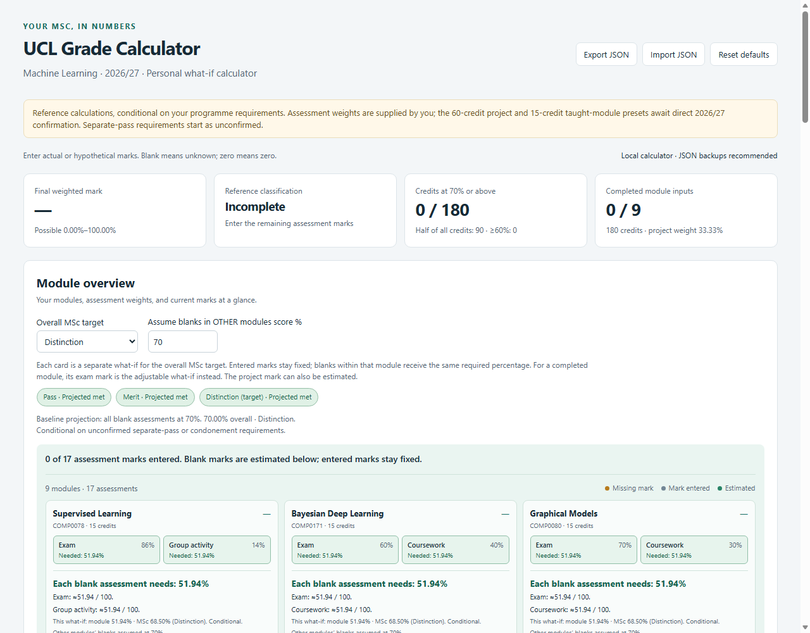

# UCL MSc Grade Calculator

Open **index.html** in a modern browser. Runs offline with no installation or server.

## Usage

- Enter marks as **achieved / available**, such as 32 / 40. Blank means unknown; zero is a real mark.
- Edit modules, credits, assessments and weights. Each module's assessment weights must total **100%**; warnings appear in its overview card.
- Grades update live. Use checkboxes for bulk deletion; deletions support undo until the next data edit.
- Open **Manage assessment categories** to add, rename or remove categories. Used categories require a replacement before removal. **Treat as exam** controls completed-module exam estimates.

## Target estimates

Select an overall **Pass, Merit or Distinction** target and an assumed percentage for blanks in **other modules**.

Each module card independently estimates the same required percentage across its blank assessments, keeping entered marks fixed. Completed modules instead show an exam/project what-if; completed modules without exams stay fixed.

**Cards are separate alternatives: do not combine their suggested marks into one forecast.** Estimates never overwrite entered marks. Classification badges show entered results when complete, or a labelled baseline projection when marks are missing.

## Saving and assumptions

- Browser autosave stores marks, categories and forecast settings. Use **Export/Import JSON** for portable backups; moving the HTML file or changing browsers may lose access to autosave.
- Eight taught modules and a project are preloaded. The 15-credit taught modules, 60-credit project and supplied weights remain editable; direct 2026/27 programme confirmation is pending.
- Results use UCL's 2026/27 taught postgraduate reference rules, conditional on separate-pass and condonement requirements. Configure these where known. Official sources and details are inside the app.
- Enter marks after any official caps or penalties; the app does not calculate those adjustments.

See [project_plan.md](project_plan.md) for the full scope.

## Development check

Run `python tests/browser_check.py` with an existing Edge/Chrome installation and Python's `websocket-client` package. These dependencies are only for testing.
